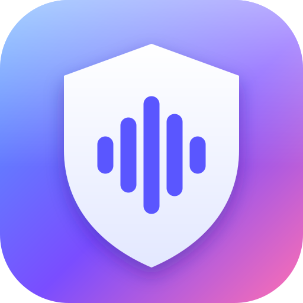
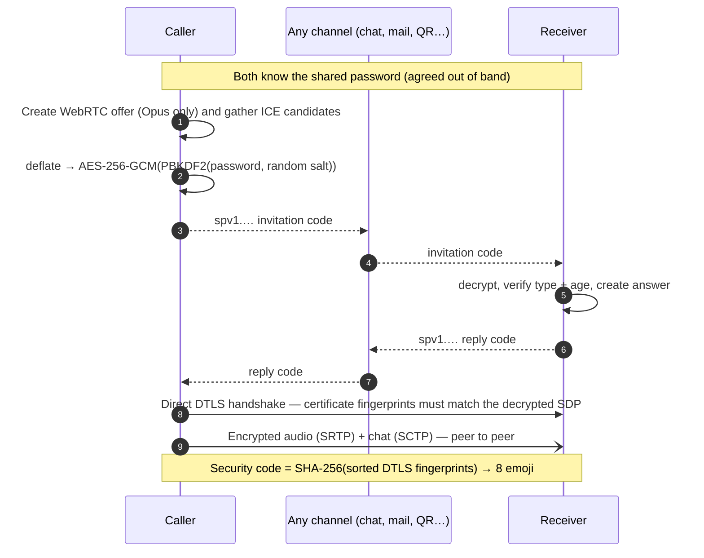

<div align="center">



# Secure P2P Voice

**Serverless, end-to-end encrypted voice calls in your browser.**
No accounts. No servers. No logs.

[](LICENSE)
[](https://webrtc.org/)
[](#-security-model)
[](#-project-structure)
[](https://github.com/furkiak/secure-p2p-voice/actions/workflows/ci.yml)

[English](#english) · [Türkçe](#türkçe)

</div>

---

<a name="english"></a>

# 🇬🇧 English

Secure P2P Voice connects two browsers **directly** — there is no signaling server, no database and no account.
Instead of a server relaying the connection details, the two people exchange a short **encrypted code**
through any channel they like (chat, e‑mail, QR code, a link). From that moment on, audio flows straight from
device to device, encrypted with DTLS‑SRTP.

The whole app is a handful of static files. Open `index.html`, host it anywhere, or install it as an app.

## ✨ Features

| | |
|---|---|
| 🔐 **Password-locked codes** | Connection codes are sealed with **AES‑256‑GCM**; the key comes from your shared password via **PBKDF2‑SHA‑256 (600 000 iterations)** with a fresh random salt for every code. |
| 🧩 **Tiny codes** | The session description is compressed before encryption: a typical code is **~1 100 characters** (the previous format needed ~10 000). |
| 🔗 **Share link & QR** | One tap shares a link whose fragment (`#c=…`) carries the code — fragments are never sent to a server. Show it as a **QR code**; scan replies in‑app where the browser supports it. |
| 🛡️ **Security code** | Both screens show the same 8 emoji derived from the DTLS fingerprints. Read them out loud to rule out a man in the middle. |
| 💬 **Encrypted chat** | Text messages travel over the same encrypted peer connection, rendered strictly as text. |
| 📊 **Live connection details** | Route (local / direct / relayed), latency, jitter, packet loss and bitrate, plus a quality indicator. |
| 🎙️ **Audio controls** | Mute (key **M**), echo cancellation, noise suppression, auto gain, microphone and speaker selection, voice quality presets (16 / 32 / 64 kbps), Opus only. |
| 👂 **Listen‑only mode** | No microphone? You can still join, listen and chat. |
| 🎲 **Password helper** | One‑tap strong passphrase (~79 bits, easy to read aloud), strength meter and offline‑guessing warning. |
| 🌐 **Network choices** | Google or Cloudflare STUN, **no third party at all** (same network only), or your own STUN/TURN servers with “relay only”. |
| 📴 **Installable & offline** | PWA with a service worker: calls on the same Wi‑Fi work without internet. |
| 🌍 **Languages & themes** | English / Türkçe (auto‑detected), light / dark / automatic. |
| ♿ **Accessible** | Keyboard friendly, ARIA labels and live regions, respects *reduced motion*, *reduced transparency* and *increased contrast*. |
| 🪟 **Liquid Glass design** | Translucent, light‑bending surfaces, specular edges, spring motion — inspired by macOS’s Liquid Glass. |

## 🚀 Quick start

1. Open the app on both devices (hosted over **HTTPS**, or `http://localhost`, or `index.html` from disk).
2. **Agree on a password** — ideally tap the 🎲 to generate one and tell it to your contact in person or by phone. Never send it together with the code.
3. **Caller:** *Start a call → Create invitation*, then send the code, link or QR to your contact.
4. **Receiver:** *Join a call*, paste the code (or just open the link), tap *Create reply*, and send the reply back.
5. **Caller:** paste (or scan) the reply and tap **Connect**.
6. Compare the **security code** emoji out loud and tap *They match*. Talk.

> Finish steps 3–5 within a couple of minutes. The codes stay valid for 30 minutes, but NAT mappings that were
> opened for the call can expire sooner.

## 🧠 How it works



### Code format

```
spv1.<base64url>      version(1) flags(1) kdf-cost(1) salt(16) iv(12) length(2) │ ciphertext+tag(16)
                      └──────────────── 33‑byte header, authenticated as AES‑GCM AAD ─────────────┘
```

* The **type** (invitation / reply) and compression flag live in the authenticated header, so an invitation can
  never be replayed as a reply, and the app can tell you *“that is an invitation, but a reply is expected”*
  without needing the password.
* The plaintext starts with a **timestamp**; codes older than 30 minutes are rejected.
* Truncated codes are detected precisely (*“the code is incomplete”*) instead of failing as a wrong password.

## 🔒 Security model

**What protects you**

* **Signaling confidentiality & authenticity:** only someone who knows the password can read a code or produce a valid one. The DTLS certificate fingerprint travels inside the encrypted code, so a network attacker can not substitute their own.
* **Media:** DTLS‑SRTP with per‑call ephemeral keys (forward secrecy for the audio even if the password leaks later).
* **No server, no logs:** nobody operates infrastructure that could record who called whom.
* **Hardened page:** a strict Content‑Security‑Policy (`default-src 'none'`, `script-src 'self'`, **`connect-src 'none'`**) means the page can only run its own files and can not make HTTP or WebSocket requests of its own (the WebRTC connection to your contact is its only network traffic); there is no inline script, no `eval`, no third‑party resource.
* **Hygiene:** the password lives only in memory and is dropped (together with all codes) as soon as the call connects; it is never written to storage.

**What you should know**

* **The password is the weak spot.** Anyone who captures a code can try passwords offline. PBKDF2 with 600 000 iterations slows that down, but only a strong password stops it — use the generator.
* **Peers see each other’s IP address,** and an enabled STUN server (Google / Cloudflare) sees yours when you create a code. Choose *None* in **Settings → Network** for same‑network calls, or use a VPN / your own TURN with *relay only*.
* The 48‑bit **security code** is a second line of defence against someone who already knows the password; it is not a replacement for a strong one.
* **You trust the host of the files.** If you serve the app from someone else’s domain, you trust them not to change it. Self‑host it (it is just static files) or run it from disk. The code is small and has no dependencies, so it is easy to review.
* Symmetric NATs and strict firewalls may need a TURN server (**Settings → Network → Custom servers**).
* This project has **not** had an independent security audit.

## ⚙️ Settings

| Setting | What it does |
|---|---|
| Language / Theme | English, Türkçe or automatic · light, dark or automatic |
| Display name | Optional; sent to your contact over the encrypted channel only |
| Microphone / Speaker | Pick devices; changing the microphone mid‑call swaps the track live |
| Voice quality | 16 / 32 / 64 kbps Opus |
| Echo cancellation · Noise suppression · Automatic gain | Standard browser audio processing |
| Connection helper | Google STUN (default) · Cloudflare STUN · None · Custom |
| Custom servers | One per line: `stun:host:3478` or `turn:host:3478 username password`; *Relay only* hides your IP from the peer |

Settings are stored in `localStorage` of your browser only.

## 🌍 Browser support

Current versions of **Chrome / Edge 123+**, **Safari 17.5+** and **Firefox 120+** (the design uses `light-dark()` and `color-mix()`).
QR scanning and speaker selection depend on browser support (Chromium‑based browsers) and are hidden elsewhere.
Microphone access requires HTTPS or `localhost`.

## 📦 Hosting

It is plain static files — no build step.

* **GitHub Pages:** *Settings → Pages → Deploy from a branch → `main` / root.*
* **Any static host** (Netlify, Cloudflare Pages, nginx, S3…): upload the repository contents.
* **Locally:** `npm start` (or `python3 -m http.server`) and open `http://localhost:8080`.

## 🛠️ Development

```bash
npm install            # dev tools only; the app itself has no dependencies
npm start              # static server on http://localhost:8080
npm test               # 41 unit + static checks (crypto, codec, QR, SAS, i18n, CSP …)
npm run lint
npx playwright install chromium && npm run test:e2e   # two real browsers hold an encrypted call
```

The end‑to‑end test drives two browser sessions through the entire flow — wrong password, truncated and swapped
codes, connection, matching security codes, audio actually arriving, chat (as text, never HTML), mute sync, hang up,
invitation links, settings — and fails on any console error.
The QR encoder was additionally verified against two independent decoders (zxing‑cpp and OpenCV) for **all 40 versions × 4
error‑correction levels**.

### 📁 Project structure

```
index.html            markup (no inline script/style), CSP, icon sprite
css/app.css           Liquid Glass design system, light/dark tokens
js/util.js            base64url, bytes, random, storage helpers, error type
js/crypto.js          PBKDF2 + AES‑GCM packets, passphrases, strength estimate
js/codec.js           deflate + envelope, code ⇄ SDP, link/paste parsing
js/sas.js             security‑code (emoji) from DTLS fingerprints
js/qr.js              dependency‑free QR encoder (ISO/IEC 18004)
js/call.js            WebRTC session, ICE gathering, data channel, stats, meters
js/i18n.js            English / Türkçe
js/ui.js              DOM helpers: toasts, clipboard/share, QR rendering, theme
js/app.js             application state machine and event wiring
sw.js · manifest.webmanifest · icons/    offline + install support
tests/                unit, static and end‑to‑end tests
scripts/serve.cjs     tiny static server
```

Modules are plain scripts attached to one `SPV` namespace, so the app runs from `file://` and the same files are
`require()`d by the Node tests.

## 🩺 Troubleshooting

| Symptom | Fix |
|---|---|
| *“Couldn’t unlock the code”* | The passwords differ (check spaces/typos) — or the code was altered. |
| *“The code is incomplete”* | Part of the code was cut off while copying; copy the whole text again. |
| *“This code has expired”* | Codes last 30 minutes; also check that both device clocks are roughly correct. |
| Stuck on *Establishing a direct connection…* | Restrictive NAT/firewall. Try the same Wi‑Fi, another network, or add a TURN server. Finish the exchange quickly. |
| No sound | Tap *Tap to enable sound* if it appears; check the speaker and the other side’s mute state. |
| No microphone prompt | The page must be served over HTTPS or `localhost`. |

## 📝 Changelog

See [CHANGELOG.md](CHANGELOG.md).

---

<a name="türkçe"></a>

# 🇹🇷 Türkçe

Secure P2P Voice, iki tarayıcıyı **doğrudan** birbirine bağlar: sinyalleşme sunucusu, veritabanı ya da hesap yoktur.
Bağlantı bilgilerini bir sunucunun aktarması yerine iki kişi, istedikleri kanaldan (mesajlaşma, e‑posta, QR kod, bağlantı)
kısa bir **şifreli kod** değiş tokuş eder. Bundan sonra ses, DTLS‑SRTP ile şifrelenerek cihazdan cihaza doğrudan akar.

Uygulamanın tamamı birkaç statik dosyadan oluşur: `index.html`'i açın, istediğiniz yerde barındırın ya da uygulama olarak yükleyin.

## ✨ Özellikler

| | |
|---|---|
| 🔐 **Parolayla kilitli kodlar** | Bağlantı kodları **AES‑256‑GCM** ile şifrelenir; anahtar, ortak parolanızdan **PBKDF2‑SHA‑256 (600 000 tur)** ile ve her kod için yeni rastgele tuzla türetilir. |
| 🧩 **Çok kısa kodlar** | Oturum açıklaması şifrelemeden önce sıkıştırılır: tipik bir kod **~1 100 karakter** (önceki biçim ~10 000 karakter gerektiriyordu). |
| 🔗 **Paylaşım bağlantısı ve QR** | Tek dokunuşla, kodu `#c=…` parçasında taşıyan bir bağlantı paylaşırsınız; URL parçası hiçbir sunucuya gönderilmez. **QR kod** gösterebilir, desteklenen tarayıcılarda yanıtı uygulama içinden tarayabilirsiniz. |
| 🛡️ **Güvenlik kodu** | İki ekranda da DTLS parmak izlerinden türetilen aynı 8 emoji görünür. Sesli karşılaştırarak ortadaki adam saldırısını elersiniz. |
| 💬 **Şifreli sohbet** | Metin mesajları aynı şifreli eşler arası bağlantıdan geçer ve yalnızca düz metin olarak gösterilir. |
| 📊 **Canlı bağlantı ayrıntıları** | Yol (yerel / doğrudan / aktarmalı), gecikme, titreşim, paket kaybı, bit hızı ve kalite göstergesi. |
| 🎙️ **Ses kontrolleri** | Sessize alma (**M** tuşu), yankı engelleme, gürültü bastırma, otomatik ses seviyesi, mikrofon ve hoparlör seçimi, ses kalitesi ön ayarları (16 / 32 / 64 kbps), yalnızca Opus. |
| 👂 **Yalnızca dinleme modu** | Mikrofonunuz yok mu? Yine de katılabilir, dinleyebilir ve yazışabilirsiniz. |
| 🎲 **Parola yardımcısı** | Tek dokunuşla güçlü parola (~79 bit, sesli okunması kolay), güç göstergesi ve çevrimdışı tahmin uyarısı. |
| 🌐 **Ağ seçenekleri** | Google veya Cloudflare STUN, **hiçbir üçüncü taraf olmadan** (yalnızca aynı ağ) ya da kendi STUN/TURN sunucularınız ve “yalnızca aktarma”. |
| 📴 **Yüklenebilir ve çevrimdışı** | Service worker'lı PWA: aynı Wi‑Fi üzerindeki aramalar internet olmadan da çalışır. |
| 🌍 **Dil ve tema** | English / Türkçe (otomatik algılanır), açık / koyu / otomatik. |
| ♿ **Erişilebilir** | Klavye dostu, ARIA etiketleri ve canlı bölgeler; *hareketi azalt*, *saydamlığı azalt* ve *yüksek karşıtlık* tercihlerine uyar. |
| 🪟 **Liquid Glass tasarım** | Yarı saydam, ışığı kıran yüzeyler, parlak kenarlar ve yaylı animasyonlar; macOS'in Liquid Glass diline esinlenir. |

## 🚀 Hızlı başlangıç

1. Uygulamayı iki cihazda da açın (**HTTPS** üzerinden, `http://localhost` ile ya da diskten `index.html`).
2. **Parola belirleyin.** En iyisi 🎲 ile oluşturup kişiye yüz yüze ya da telefonda söylemektir. Parolayı asla kodla birlikte göndermeyin.
3. **Arayan:** *Arama başlat → Davet oluştur*; ardından kodu, bağlantıyı ya da QR'ı karşı tarafa gönderin.
4. **Aranan:** *Aramaya katıl*; kodu yapıştırın (veya bağlantıyı açın), *Yanıt oluştur*'a dokunun ve yanıtı geri gönderin.
5. **Arayan:** yanıtı yapıştırın (veya tarayın) ve **Bağlan**'a dokunun.
6. **Güvenlik kodu** emojilerini sesli karşılaştırın, *Aynı*'ya dokunun. Konuşmaya başlayın.

> 3–5. adımları birkaç dakika içinde tamamlayın. Kodlar 30 dakika geçerlidir; ancak arama için açılan NAT eşleşmeleri
> daha önce zaman aşımına uğrayabilir.

## 🧠 Nasıl çalışır?

Şema ve kod biçimi için yukarıdaki [How it works](#-how-it-works) bölümüne bakın. Özet:

1. Arayan, yalnızca Opus içeren bir WebRTC teklifi üretir ve ağ adaylarını toplar.
2. Teklif sıkıştırılır → parolanızdan (rastgele tuzlu PBKDF2) türetilen anahtarla **AES‑256‑GCM** ile şifrelenir → `spv1.…` kodu olur.
3. Aranan kodu çözer; **türünü ve yaşını** doğrular, yanıtı üretir ve aynı yöntemle şifreleyip geri gönderir.
4. İki cihaz doğrudan DTLS el sıkışması yapar. Sertifika parmak izleri, şifreli koddan çıkan SDP ile **birebir eşleşmek zorundadır**.
5. Ses (SRTP) ve sohbet (SCTP) eşler arası akar. Güvenlik kodu, iki parmak izinin SHA‑256 özetinden türetilen 8 emojidir.

Kodun başlığındaki **tür** (davet / yanıt) ve sıkıştırma bayrağı doğrulanmış başlığın parçasıdır. Bu yüzden bir davet yanıt
yerine kullanılamaz ve uygulama, parolaya gerek kalmadan *“bu bir davet, burada yanıt gerekiyor”* diyebilir.
Eksik kopyalanmış kodlar yanlış parola gibi değil, *“kod eksik”* olarak bildirilir.

## 🔒 Güvenlik modeli

**Sizi ne korur**

* **Sinyalleşme gizliliği ve doğrulaması:** Kodu yalnızca parolayı bilen okuyabilir ya da geçerli bir kod üretebilir. DTLS sertifika parmak izi şifreli kodun içinde taşındığı için ağdaki bir saldırgan kendi parmak izini araya sokamaz.
* **Medya:** Her arama için geçici anahtarlarla DTLS‑SRTP (parola sonradan sızsa bile ses için ileriye dönük gizlilik).
* **Sunucu yok, kayıt yok:** Kimin kimi aradığını kaydedebilecek bir altyapı işleten kimse yoktur.
* **Sertleştirilmiş sayfa:** Sıkı bir İçerik Güvenliği Politikası (`default-src 'none'`, `script-src 'self'`, **`connect-src 'none'`**) sayfanın yalnızca kendi dosyalarını çalıştırmasını ve kendi başına HTTP ya da WebSocket isteği yapamamasını sağlar (tek ağ trafiği, karşı tarafla kurulan WebRTC bağlantısıdır). Satır içi betik, `eval` ya da üçüncü taraf kaynak yoktur.
* **Hijyen:** Parola yalnızca bellekte tutulur; arama bağlanır bağlanmaz tüm kodlarla birlikte silinir ve hiçbir zaman depolamaya yazılmaz.

**Bilmeniz gerekenler**

* **Zayıf halka paroladır.** Bir kodu ele geçiren kişi parolaları çevrimdışı deneyebilir. 600 000 turluk PBKDF2 bunu yavaşlatır, ancak yalnızca güçlü bir parola durdurur; oluşturucuyu kullanın.
* **Eşler birbirinin IP adresini görür** ve etkin bir STUN sunucusu (Google / Cloudflare), kod oluşturduğunuzda sizinkini görür. Aynı ağdaki aramalar için **Ayarlar → Ağ**'da *Yok*'u seçin; ya da VPN / kendi TURN sunucunuzu “yalnızca aktarma” ile kullanın.
* 48 bitlik **güvenlik kodu**, parolayı zaten bilen birine karşı ikinci bir savunmadır; güçlü parolanın yerini tutmaz.
* **Dosyaları barındırana güveniyorsunuz.** Uygulamayı başkasının alan adından açarsanız onun değiştirmeyeceğine güvenirsiniz. Kendiniz barındırın (yalnızca statik dosyalar) ya da diskten çalıştırın. Kod küçüktür ve bağımlılığı yoktur, incelemesi kolaydır.
* Simetrik NAT'lar ve katı güvenlik duvarları TURN sunucusu gerektirebilir (**Ayarlar → Ağ → Özel sunucular**).
* Bu proje **bağımsız bir güvenlik denetiminden geçmemiştir.**

## ⚙️ Ayarlar

| Ayar | Ne yapar |
|---|---|
| Dil / Tema | English, Türkçe ya da otomatik · açık, koyu ya da otomatik |
| Görünen ad | İsteğe bağlı; yalnızca şifreli kanaldan karşı tarafa gönderilir |
| Mikrofon / Hoparlör | Cihaz seçimi; arama sırasında mikrofon değişimi kanalı canlı olarak değiştirir |
| Ses kalitesi | 16 / 32 / 64 kbps Opus |
| Yankı engelleme · Gürültü bastırma · Otomatik ses seviyesi | Standart tarayıcı ses işleme |
| Bağlantı yardımcısı | Google STUN (varsayılan) · Cloudflare STUN · Yok · Özel |
| Özel sunucular | Her satıra bir tane: `stun:host:3478` veya `turn:host:3478 kullanıcı parola`; *Yalnızca aktarma* IP'nizi karşı taraftan gizler |

Ayarlar yalnızca tarayıcınızın `localStorage` alanında saklanır.

## 🌍 Tarayıcı desteği

**Chrome / Edge 123+**, **Safari 17.5+** ve **Firefox 120+** güncel sürümleri (tasarım `light-dark()` ve `color-mix()` kullanır).
QR tarama ve hoparlör seçimi tarayıcı desteğine (Chromium tabanlılar) bağlıdır; desteklenmeyen yerlerde gizlenir.
Mikrofon erişimi için HTTPS veya `localhost` gerekir.

## 📦 Barındırma

Düz statik dosyalardır; derleme adımı yoktur.

* **GitHub Pages:** *Settings → Pages → Deploy from a branch → `main` / root.*
* **Herhangi bir statik barındırma** (Netlify, Cloudflare Pages, nginx, S3…): depo içeriğini yükleyin.
* **Yerel:** `npm start` (ya da `python3 -m http.server`) ve `http://localhost:8080` adresini açın.

## 🛠️ Geliştirme

```bash
npm install            # yalnızca geliştirme araçları; uygulamanın kendisinin bağımlılığı yok
npm start              # http://localhost:8080 üzerinde statik sunucu
npm test               # 41 birim + statik kontrol (kripto, kodlayıcı, QR, SAS, i18n, CSP …)
npm run lint
npx playwright install chromium && npm run test:e2e   # iki gerçek tarayıcı şifreli bir arama yapar
```

Uçtan uca test, iki tarayıcı oturumunu tüm akıştan geçirir: yanlış parola, eksik ve karıştırılmış kodlar, bağlantı,
eşleşen güvenlik kodları, sesin gerçekten ulaşması, sohbet (HTML değil, metin olarak), sessize alma eşitlemesi, görüşmeyi
bitirme, davet bağlantıları ve ayarlar. Konsolda tek bir hata olursa başarısız olur.
QR kodlayıcı ayrıca iki bağımsız çözücüyle (zxing‑cpp ve OpenCV) **40 sürümün × 4 hata düzeltme seviyesinin tamamı** için doğrulanmıştır.

Dosya yapısı için yukarıdaki [Project structure](#-project-structure) bölümüne bakın. Modüller tek bir `SPV` ad alanına bağlanan düz
betiklerdir; bu sayede uygulama `file://` üzerinden çalışır ve aynı dosyalar Node testlerinde `require()` ile yüklenir.

## 🩺 Sorun giderme

| Belirti | Çözüm |
|---|---|
| *“Kodun kilidi açılamadı”* | Parolalar farklı (boşluk / yazım hatasını kontrol edin) ya da kod değiştirilmiş. |
| *“Kod eksik”* | Kopyalarken kodun bir kısmı kesilmiş; metnin tamamını yeniden kopyalayın. |
| *“Bu kodun süresi dolmuş”* | Kodlar 30 dakika geçerlidir; iki cihazın saatinin de yaklaşık doğru olduğundan emin olun. |
| *Doğrudan bağlantı kuruluyor…* ekranında takılıyor | Kısıtlayıcı NAT / güvenlik duvarı. Aynı Wi‑Fi'yi, başka bir ağı deneyin ya da TURN sunucusu ekleyin. Değişimi hızlı tamamlayın. |
| Ses yok | *Sesi açmak için dokunun* düğmesi çıkarsa dokunun; hoparlörü ve karşı tarafın sessiz durumunu kontrol edin. |
| Mikrofon izni sorulmuyor | Sayfa HTTPS veya `localhost` üzerinden sunulmalıdır. |

## 📝 Sürüm notları

[CHANGELOG.md](CHANGELOG.md) dosyasına bakın.

---

## License

[MIT](LICENSE) © 2026 Furkan Akça — free to use, modify and distribute.
