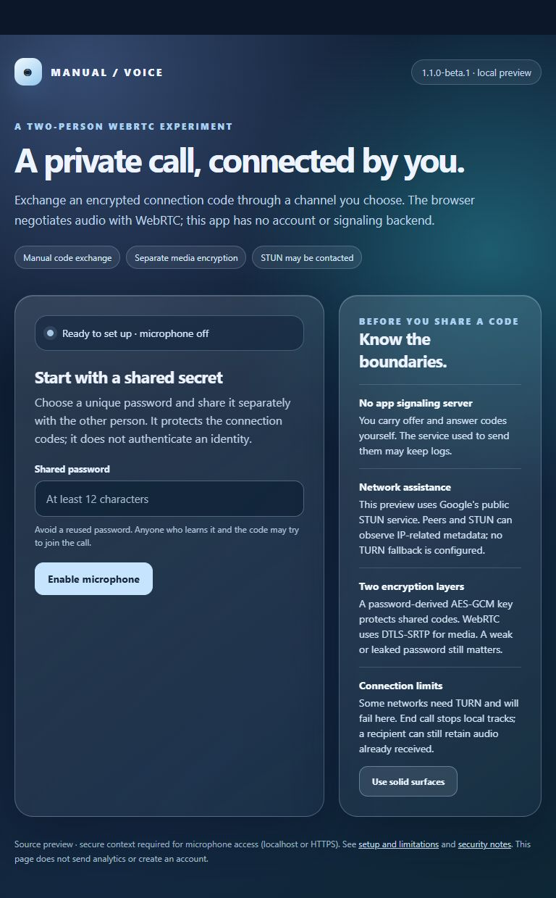

# Manual P2P Voice

A two-person browser voice experiment. You exchange an encrypted WebRTC offer and answer by copying codes through a channel of your choice. The app has no account, database, analytics, or application signaling server. **It contacts a public STUN service by default, and the channel you use for code exchange may keep logs.**



*Local browser capture, 28 September 2026: the microphone is off, the password field is empty, and no call has been established. The image shows the current entry screen; it does not verify a two-device call.*

## Try it locally

Requirements: a modern browser with WebRTC/Web Crypto, a microphone, and Python 3 or any static-file server. No npm install is needed for the app.

```sh
python -m http.server 8044 --bind 127.0.0.1
```

Open `http://127.0.0.1:8044/` in each local browser. For another device, serve the files over **HTTPS**; a non-local plain HTTP page normally cannot request a microphone. Only grant microphone access after checking the page's origin and the person you intend to call. `file://` behavior varies by browser, so use a local server.

1. Agree on a **unique** shared password of at least 12 Unicode characters and at most 128 UTF-8 bytes. Share it through a different channel from the offer/answer codes. A password manager-generated phrase is preferable to a memorable or reused password.
2. Both parties enter the password and choose **Enable microphone**. The browser asks for permission. The app keeps the password only in this tab's memory until you end the call or leave the page.
3. Caller selects **I am calling**, generates an offer, and sends the entire code to the intended recipient.
4. Receiver selects **I am receiving**, pastes the offer, generates an answer, and sends the entire answer code back.
5. Caller pastes the answer and selects **Connect**. Either person can mute or select **End call & stop mic**. Closing the tab also stops the local tracks.

If a code fails, check that both parties used the same password and the right call step. Generate a fresh offer if the session has changed. Version 1 codes are intentionally incompatible with the current version 2 format. Some networks require a TURN relay; this preview has **no TURN configuration** and may fail to connect. The receiver can generate an answer while the caller remains offline, but both parties must be online for the call to connect.

## What is protected

The offer/answer is encrypted in the browser with AES-256-GCM and a key derived from the shared password using PBKDF2-SHA-256 (250,000 iterations, fresh 16-byte salt per code). A fresh 12-byte nonce is used for each code. The code format binds its version, offer/answer type, and call ID as authenticated data. WebRTC's DTLS-SRTP protects the audio transport separately. The app does **not** independently authenticate your peer; a person who obtains the password and codes may impersonate a participant, and a weak password can be guessed offline from a captured code. See [SECURITY.md](SECURITY.md) for the threat model and reporting route.

The encryption is specific to signaling; it does not prevent the recipient from recording received audio. The peer and STUN service can learn IP-related metadata. A browser, operating system, extension, hosting provider, or code-sharing service may have its own logging. There is no claim of anonymity, zero logs, or universal direct connectivity.

## Architecture and verification

```text
Caller browser  -- encrypted offer via your chosen channel --> Receiver browser
Caller browser  <-- encrypted answer via your chosen channel -- Receiver browser
       |                                                        |
       +---- STUN-assisted ICE, then WebRTC DTLS-SRTP audio ----+
```

`index.html` is the dependency-free interface; `app.js` manages the call lifecycle; `crypto.js` implements the versioned code envelope. `test/crypto.test.js` runs without a microphone:

```sh
npm test
node --check app.js
node --check crypto.js
```

These automated tests validate code round trips and input rejection. They do **not** prove that a two-device call works on every browser or network. Before a public release, use the [manual acceptance checklist](docs/manual-acceptance.md), including separate devices and networks.

| Environment | Current evidence |
| --- | --- |
| Local static page in the Codex in-app browser | Landing page with microphone off captured; short-password rejection and solid-surface control observed |
| Chromium, Firefox, Safari with two microphones | Call and compatibility not yet verified |
| Separate networks, mobile devices, TURN-restricted networks | Not yet verified; TURN is not configured |

If a new build causes trouble, serve or deploy the previous static-file Git revision. Do not mix old and new scripts in one deployment. Version 1 and version 2 codes cannot be exchanged; both people must reload the same revision and create fresh codes. Existing calls should be ended before switching revisions.

## Türkçe özet

Bu proje iki tarayıcı arasında elle kopyalanan şifreli WebRTC bağlantı kodlarıyla ses görüşmesi dener. Uygulamanın hesap veya sinyalleşme sunucusu yoktur; fakat Google'ın genel STUN hizmeti kullanılır. Kod gönderdiğiniz uygulama kayıt tutabilir, karşı taraf ve STUN IP ile ilgili verileri görebilir. En az 12 Unicode karakterden oluşan, 128 UTF-8 baytı aşmayan benzersiz bir parola kullanın ve koddan ayrı bir kanalda iletin. Bağlantı kurulamayan ağlarda TURN gerekebilir; bu önizlemede TURN yoktur. Görüşmeyi bitirince yerel mikrofon izleri durdurulur. Güvenlik sınırları için [SECURITY.md](SECURITY.md) dosyasına bakın.

Licensed under [MIT](LICENSE). Contributions are described in [CONTRIBUTING.md](CONTRIBUTING.md); troubleshooting is in [SUPPORT.md](SUPPORT.md).
